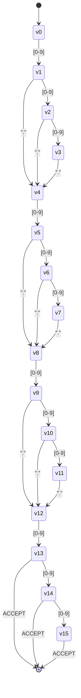
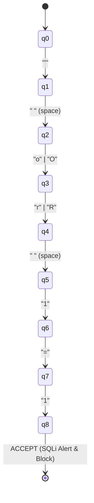
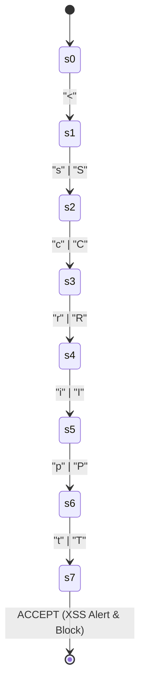
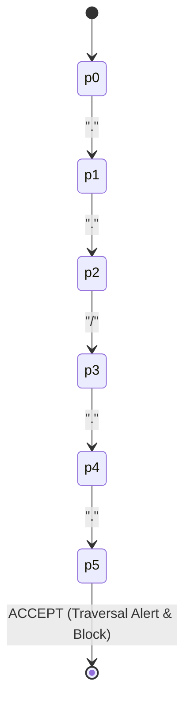

# Formal Automata Design, State Transition Diagrams & Transition Tables

**Course / Topic**: Topic 23 - Network Intrusion Detection System Using Regular Expressions and Finite Automata  
**Project**: Campus Defender Network Intrusion Detection System (NIDS)  
**Deliverable**: Formal Automata Design, State Diagrams, and Transition Tables for Pattern Detection and User Form Input Validation

---

## 1. Theoretical Foundation

In Theory of Computation and Formal Language Theory, a **Deterministic Finite Automaton (DFA)** is formally represented as a 5-tuple:

$$M = (Q, \Sigma, \delta, q_0, F)$$

Where:
- **$Q$**: A finite, non-empty set of states.
- **$\Sigma$**: A finite set of input symbols called the alphabet.
- **$\delta$**: The transition function $\delta : Q \times \Sigma \to Q$.
- **$q_0 \in Q$**: The unique initial (start) state.
- **$F \subseteq Q$**: The set of final or accepting states.

In this Network Intrusion Detection System (NIDS), finite automata are deployed for two critical purposes:
1. **User Form Input Validation**: Ensuring client-submitted network configurations (e.g., IPv4 addresses and port bounds) conform strictly to syntax standards before processing.
2. **Deep Packet Payload Inspection**: Scanning incoming packet streams for malicious signatures (such as SQL Injection, Cross-Site Scripting, and Directory Traversal) in real time.

---

## 2. Automaton 1: User Form Input Validation (IPv4 Address DFA)

### 2.1 Problem Description
The college administrator must provide valid IPv4 addresses (`X.X.X.X` where each octet contains 1 to 3 digits separated by dots). Any malformed string (e.g., containing alphabets, invalid separators, or extra dots) must be rejected and guided to a trap/error state.

### 2.2 Regular Expression Equivalent
$$\text{Regex} = \wedge [0-9]{1,3} \cdot [0-9]{1,3} \cdot [0-9]{1,3} \cdot [0-9]{1,3} \$$

### 2.3 Formal 5-Tuple Definition
- **$Q$** = $\{ v_0, v_1, v_2, v_3, v_4, v_5, v_6, v_7, v_8, v_9, v_{10}, v_{11}, v_{12}, v_{13}, v_{14}, v_{15}, v_{\text{trap}} \}$
- **$\Sigma$** = $\{ 0, 1, 2, 3, 4, 5, 6, 7, 8, 9, . \}$
- **$q_0$** = $v_0$
- **$F$** = $\{ v_{13}, v_{14}, v_{15} \}$ (Any state where the 4th octet has 1, 2, or 3 digits without further characters)
- **$\delta$** = Transition function mapped in Section 2.5.

### 2.4 State Description
| State | Description |
|---|---|
| $v_0$ | Start state: waiting for 1st digit of 1st octet |
| $v_1$ | Read 1st digit of 1st octet |
| $v_2$ | Read 2nd digit of 1st octet |
| $v_3$ | Read 3rd digit of 1st octet |
| $v_4$ | Read 1st dot separator (`.`) |
| $v_5$ | Read 1st digit of 2nd octet |
| $v_6$ | Read 2nd digit of 2nd octet |
| $v_7$ | Read 3rd digit of 2nd octet |
| $v_8$ | Read 2nd dot separator (`.`) |
| $v_9$ | Read 1st digit of 3rd octet |
| $v_{10}$ | Read 2nd digit of 3rd octet |
| $v_{11}$ | Read 3rd digit of 3rd octet |
| $v_{12}$ | Read 3rd dot separator (`.`) |
| $v_{13}$ | **ACCEPT STATE**: Read 1st digit of 4th octet |
| $v_{14}$ | **ACCEPT STATE**: Read 2nd digit of 4th octet |
| $v_{15}$ | **ACCEPT STATE**: Read 3rd digit of 4th octet |
| $v_{\text{trap}}$ | Dead / Trap state for any invalid input symbol or excess characters |

### 2.5 State Transition Table: IPv4 Form Validation DFA
*(Note: $\rightarrow$ indicates Start state; $*$ indicates Accept state)*

| State | Input: `[0-9]` | Input: `.` | Input: Other (Invalid) |
|---|:---:|:---:|:---:|
| $\rightarrow v_0$ | $v_1$ | $v_{\text{trap}}$ | $v_{\text{trap}}$ |
| $v_1$ | $v_2$ | $v_4$ | $v_{\text{trap}}$ |
| $v_2$ | $v_3$ | $v_4$ | $v_{\text{trap}}$ |
| $v_3$ | $v_{\text{trap}}$ | $v_4$ | $v_{\text{trap}}$ |
| $v_4$ | $v_5$ | $v_{\text{trap}}$ | $v_{\text{trap}}$ |
| $v_5$ | $v_6$ | $v_8$ | $v_{\text{trap}}$ |
| $v_6$ | $v_7$ | $v_8$ | $v_{\text{trap}}$ |
| $v_7$ | $v_{\text{trap}}$ | $v_8$ | $v_{\text{trap}}$ |
| $v_8$ | $v_9$ | $v_{\text{trap}}$ | $v_{\text{trap}}$ |
| $v_9$ | $v_{10}$ | $v_{12}$ | $v_{\text{trap}}$ |
| $v_{10}$ | $v_{11}$ | $v_{12}$ | $v_{\text{trap}}$ |
| $v_{11}$ | $v_{\text{trap}}$ | $v_{12}$ | $v_{\text{trap}}$ |
| $v_{12}$ | $v_{13}$ | $v_{\text{trap}}$ | $v_{\text{trap}}$ |
| $* v_{13}$ | $v_{14}$ | $v_{\text{trap}}$ | $v_{\text{trap}}$ |
| $* v_{14}$ | $v_{15}$ | $v_{\text{trap}}$ | $v_{\text{trap}}$ |
| $* v_{15}$ | $v_{\text{trap}}$ | $v_{\text{trap}}$ | $v_{\text{trap}}$ |
| $v_{\text{trap}}$ | $v_{\text{trap}}$ | $v_{\text{trap}}$ | $v_{\text{trap}}$ |

### 2.6 State Transition Diagram (Mermaid)

---

## 3. Automaton 2: Malicious Pattern Detection - SQL Injection (`' OR 1=1`)

### 3.1 Problem Description
SQL Injection authentication bypass exploits vulnerable login forms through tautologies such as `' OR 1=1`. The NIDS must identify this exact pattern inside network payload streams.

### 3.2 Formal 5-Tuple Definition
- **$Q$** = $\{ q_0, q_1, q_2, q_3, q_4, q_5, q_6, q_7, q_8 \}$
- **$\Sigma$** = $\{ ', \text{space}, o, r, 1, = \}$
- **$q_0$** = $q_0$
- **$F$** = $\{ q_8 \}$
- **$\delta$** = Transition function defined below.

### 3.3 State Description
- $q_0$: Initial state (listening for opening quote `'`)
- $q_1$: Read quote `'`
- $q_2$: Read space `' `
- $q_3$: Read `' O` (case insensitive)
- $q_4$: Read `' OR` (case insensitive)
- $q_5$: Read space after OR `' OR `
- $q_6$: Read first literal `' OR 1`
- $q_7$: Read equals sign `' OR 1=`
- $q_8$: **ACCEPT STATE**: Read second literal `' OR 1=1` $\rightarrow$ **TRIGGER SQLi ALERT & BLOCK**

### 3.4 State Transition Table: SQL Injection DFA
*(Note: $\rightarrow$ indicates Start state; $*$ indicates Accept state)*

| State | `'` | ` ` (space) | `o` / `O` | `r` / `R` | `1` | `=` | Other |
|---|:---:|:---:|:---:|:---:|:---:|:---:|:---:|
| $\rightarrow q_0$ | $q_1$ | $q_0$ | $q_0$ | $q_0$ | $q_0$ | $q_0$ | $q_0$ |
| $q_1$ | $q_1$ | $q_2$ | $q_0$ | $q_0$ | $q_0$ | $q_0$ | $q_0$ |
| $q_2$ | $q_1$ | $q_2$ | $q_3$ | $q_0$ | $q_0$ | $q_0$ | $q_0$ |
| $q_3$ | $q_1$ | $q_0$ | $q_0$ | $q_4$ | $q_0$ | $q_0$ | $q_0$ |
| $q_4$ | $q_1$ | $q_5$ | $q_0$ | $q_0$ | $q_0$ | $q_0$ | $q_0$ |
| $q_5$ | $q_1$ | $q_5$ | $q_0$ | $q_0$ | $q_6$ | $q_0$ | $q_0$ |
| $q_6$ | $q_1$ | $q_0$ | $q_0$ | $q_0$ | $q_0$ | $q_7$ | $q_0$ |
| $q_7$ | $q_1$ | $q_0$ | $q_0$ | $q_0$ | $q_8$ | $q_0$ | $q_0$ |
| $* q_8$ | — | — | — | — | — | — | — |

### 3.5 State Transition Diagram (Mermaid)

### 3.6 Sample Trace
- **Input String**: `admin' OR 1=1--`
- **Execution**:
  1. `q0 --[']--> q1`
  2. `q1 --[ ]--> q2`
  3. `q2 --['O']--> q3`
  4. `q3 --['R']--> q4`
  5. `q4 --[ ]--> q5`
  6. `q5 --['1']--> q6`
  7. `q6 --['=']--> q7`
  8. `q7 --['1']--> q8 (ACCEPT - THREAT CONFIRMED)`

---

## 4. Automaton 3: Malicious Pattern Detection - Cross-Site Scripting (XSS: `<script`)

### 4.1 Problem Description
Detects malicious inline client-side script injection tags (`<script`) in network HTTP request bodies and URL parameters.

### 4.2 Formal 5-Tuple Definition
- **$Q$** = $\{ s_0, s_1, s_2, s_3, s_4, s_5, s_6, s_7 \}$
- **$\Sigma$** = $\{ <, s, c, r, i, p, t \}$
- **$q_0$** = $s_0$
- **$F$** = $\{ s_7 \}$
- **$\delta$** = Transition function defined below.

### 4.3 State Transition Table: XSS DFA
*(Note: $\rightarrow$ indicates Start state; $*$ indicates Accept state)*

| State | `<` | `s` / `S` | `c` / `C` | `r` / `R` | `i` / `I` | `p` / `P` | `t` / `T` | Other |
|---|:---:|:---:|:---:|:---:|:---:|:---:|:---:|:---:|
| $\rightarrow s_0$ | $s_1$ | $s_0$ | $s_0$ | $s_0$ | $s_0$ | $s_0$ | $s_0$ | $s_0$ |
| $s_1$ | $s_1$ | $s_2$ | $s_0$ | $s_0$ | $s_0$ | $s_0$ | $s_0$ | $s_0$ |
| $s_2$ | $s_1$ | $s_0$ | $s_3$ | $s_0$ | $s_0$ | $s_0$ | $s_0$ | $s_0$ |
| $s_3$ | $s_1$ | $s_0$ | $s_0$ | $s_4$ | $s_0$ | $s_0$ | $s_0$ | $s_0$ |
| $s_4$ | $s_1$ | $s_0$ | $s_0$ | $s_0$ | $s_5$ | $s_0$ | $s_0$ | $s_0$ |
| $s_5$ | $s_1$ | $s_0$ | $s_0$ | $s_0$ | $s_0$ | $s_6$ | $s_0$ | $s_0$ |
| $s_6$ | $s_1$ | $s_0$ | $s_0$ | $s_0$ | $s_0$ | $s_0$ | $s_7$ | $s_0$ |
| $* s_7$ | — | — | — | — | — | — | — | — |

### 4.4 State Transition Diagram (Mermaid)

---

## 5. Automaton 4: Malicious Pattern Detection - Path Traversal (`../../`)

### 5.1 Problem Description
Detects unauthorized directory climb sequences (`../..`) that attempt to escape webroot boundaries to access sensitive system files (such as `/etc/passwd`).

### 5.2 Formal 5-Tuple Definition
- **$Q$** = $\{ p_0, p_1, p_2, p_3, p_4, p_5 \}$
- **$\Sigma$** = $\{ ., / \}$
- **$q_0$** = $p_0$
- **$F$** = $\{ p_5 \}$
- **$\delta$** = Transition function defined below.

### 5.3 State Transition Table: Directory Traversal DFA
*(Note: $\rightarrow$ indicates Start state; $*$ indicates Accept state)*

| State | `.` | `/` | Other |
|---|:---:|:---:|:---:|
| $\rightarrow p_0$ | $p_1$ | $p_0$ | $p_0$ |
| $p_1$ | $p_2$ | $p_0$ | $p_0$ |
| $p_2$ | $p_0$ | $p_3$ | $p_0$ |
| $p_3$ | $p_4$ | $p_0$ | $p_0$ |
| $p_4$ | $p_5$ | $p_0$ | $p_0$ |
| $* p_5$ | — | — | — |

### 5.4 State Transition Diagram (Mermaid)

---

## 6. Summary of Automata Coverage for Evaluation

| Target Component | Automaton ID | Type | States Count ($|Q|$) | Alphabet ($\Sigma$) | Purpose |
|---|---|---|:---:|---|---|
| **Form Input Validation** | `dfa-ipv4-validator` | DFA | 17 | `[0-9]`, `.` | Validates Source & Destination IPv4 strings |
| **SQL Injection** | `dfa-sqli` | DFA | 9 | `'`, `[space]`, `o`, `r`, `1`, `=` | Detects `' OR 1=1` auth bypass in payloads |
| **Cross-Site Scripting** | `dfa-xss` | DFA | 8 | `<`, `s`, `c`, `r`, `i`, `p`, `t` | Detects `<script` tag injection in payloads |
| **Path Traversal** | `dfa-traversal` | DFA | 6 | `.`, `/` | Detects `../..` directory climbing sequences |
