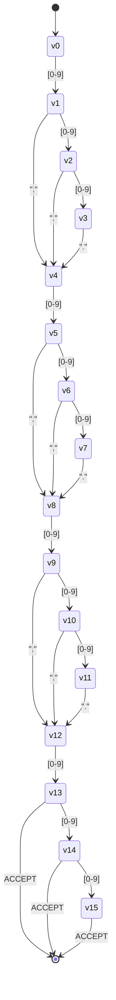
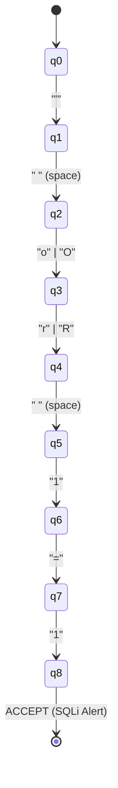
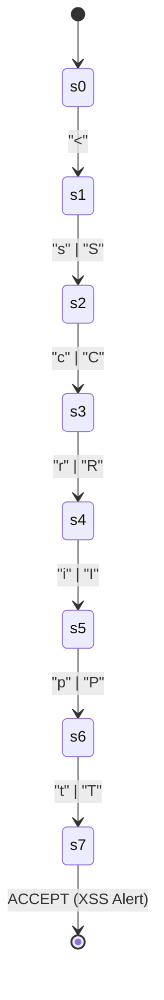
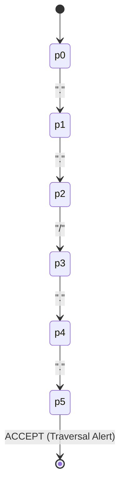

# Campus Defender NIDS: Network Intrusion Detection System
### Using Regular Expressions and Finite Automata (MERN Stack)

> 🌐 **Active Live URL**: [https://potentially-horn-saw-kick.trycloudflare.com](https://potentially-horn-saw-kick.trycloudflare.com)
> 💻 **Local Production Link**: [http://localhost:5001](http://localhost:5001)
> 📂 **Official GitHub Repository**: [https://github.com/Dharunya28998/network-intrusion-detection-system](https://github.com/Dharunya28998/network-intrusion-detection-system)

---

**Assigned Scenario (Topic 23)**:
> **Problem Statement**: A college network administrator wants to detect suspicious network traffic and display alerts on a dashboard. Develop a web application that monitors network traffic and uses regular expressions and finite automata to identify predefined malicious patterns.

---

## 📋 Table of Contents
1. [Project Overview](#-project-overview)
2. [Technology Stack](#-technology-stack)
3. [Key Features](#-key-features)
4. [Formal Automata Design & Theory](#-formal-automata-design--theory)
   - [User Form Validation Automaton (IPv4)](#1-user-form-input-validation-automaton-ipv4)
   - [SQL Injection Detection Automaton](#2-sql-injection-detection-automaton--or-11)
   - [Cross-Site Scripting (XSS) Automaton](#3-cross-site-scripting-xss-automaton-script)
   - [Directory Traversal Automaton](#4-directory-traversal-automaton-)
5. [Form Validation Rules](#-form-validation-rules)
6. [Sample Inputs and Expected Outputs](#-sample-inputs-and-expected-outputs)
7. [Installation & How to Run](#-installation--how-to-run)
8. [API Documentation](#-api-documentation)
9. [GitHub Submission Checklist](#-github-submission-checklist)

---

## 🚀 Project Overview

The **Campus Defender Network Intrusion Detection System (NIDS)** is a full-stack cybersecurity monitoring application designed for college campus networks. It inspects incoming packets at line rate, identifies malicious attack vectors using formal **Deterministic Finite Automata (DFA)** and **Regular Expression (Regex)** signatures, and triggers automated defensive actions (Packet Drop / IP Block).

The application strictly fulfills all academic requirements:
- **MERN Stack**: React frontend, Node.js & Express.js backend, and MongoDB database with resilient failover.
- **Automata Design**: Formally defined 5-tuples $M = (Q, \Sigma, \delta, q_0, F)$ for both pattern detection and form input validation.
- **State Transition Diagrams & Tables**: Rendered graphically in the UI via Mermaid and documented in tables.
- **Form Validation**: Multi-layer (client-side, server-side, and automata-driven).

---

## 🛠️ Technology Stack

| Layer | Technology | Purpose |
|---|---|---|
| **Frontend** | React 18, Vite | High-performance responsive admin dashboard |
| **Styling** | Cyber SOC Dark Theme (CSS3) | Real-time security operations center aesthetics |
| **Diagrams** | Mermaid.js | Live client-side rendering of State Transition Diagrams |
| **Icons** | Lucide React | High-tech visual status indicators |
| **Backend** | Node.js, Express.js | REST API, packet ingestion & DFA execution engine |
| **Automata** | Formal DFA Engine ($Q, \Sigma, \delta, q_0, F$) | Character-by-character state traversal and attack detection |
| **Database** | MongoDB & Mongoose | Persistent storage of packet logs, alerts & attack signatures |

---

## ✨ Key Features

1. **Real-Time Network Traffic Monitor**:
   - Inspects packet stream (Source IP, Destination IP, Port, Protocol, Payload).
   - Classifies status into `NORMAL`, `SUSPICIOUS`, or `MALICIOUS`.
   - Automated defensive response (`FORWARDED`, `ALERTED`, `DROPPED`, `BLOCKED`).
2. **Interactive Packet Injector & Validator**:
   - Complete form validation (IPv4 addresses, port ranges 1–65535, protocol, non-empty payload).
   - 1-Click Attack Scenario Presets (SQL Injection, XSS, Path Traversal, Command Injection, Port Scan).
   - Real-time error feedback and step-by-step automata transition trace display.
3. **Security Incident & Alert Center**:
   - Severity tags: `CRITICAL`, `HIGH`, `MEDIUM`, `LOW`.
   - Threat details: Matched signature, offender IP, targeted port, and admin mitigation advice.
4. **Automata Theory & Transition Table Explorer**:
   - Formal 5-tuple specifications $M = (Q, \Sigma, \delta, q_0, F)$.
   - State Transition Diagrams (graphical state charts).
   - Complete State Transition Tables.
   - **Interactive DFA Step-by-Step Simulator**: Type any string and watch the DFA step through states in real time!

---

## 🧠 Formal Automata Design & Theory

A Deterministic Finite Automaton (DFA) is formally denoted as:
$$M = (Q, \Sigma, \delta, q_0, F)$$

### 1. User Form Input Validation Automaton (IPv4)
Validates that submitted network addresses match the canonical IPv4 format (`D.D.D.D` where $D \in [0-9]{1,3}$).
- **States ($Q$)**: $\{ v_0, v_1, v_2, \dots, v_{15}, v_{\text{trap}} \}$
- **Alphabet ($\Sigma$)**: $\{ 0, 1, 2, 3, 4, 5, 6, 7, 8, 9, . \}$
- **Start State**: $v_0$
- **Accept States ($F$)**: $\{ v_{13}, v_{14}, v_{15} \}$

#### State Transition Diagram


#### State Transition Table (IPv4 Validation)
| State | Input: `[0-9]` | Input: `.` | Other (Invalid) |
|---|:---:|:---:|:---:|
| $\rightarrow v_0$ | $v_1$ | $v_{\text{trap}}$ | $v_{\text{trap}}$ |
| $v_1$ | $v_2$ | $v_4$ | $v_{\text{trap}}$ |
| $v_2$ | $v_3$ | $v_4$ | $v_{\text{trap}}$ |
| $v_3$ | $v_{\text{trap}}$ | $v_4$ | $v_{\text{trap}}$ |
| $v_4$ | $v_5$ | $v_{\text{trap}}$ | $v_{\text{trap}}$ |
| $v_5$ | $v_6$ | $v_8$ | $v_{\text{trap}}$ |
| $v_6$ | $v_7$ | $v_8$ | $v_{\text{trap}}$ |
| $v_7$ | $v_{\text{trap}}$ | $v_8$ | $v_{\text{trap}}$ |
| $v_8$ | $v_9$ | $v_{\text{trap}}$ | $v_{\text{trap}}$ |
| $v_9$ | $v_{10}$ | $v_{12}$ | $v_{\text{trap}}$ |
| $v_{10}$ | $v_{11}$ | $v_{12}$ | $v_{\text{trap}}$ |
| $v_{11}$ | $v_{\text{trap}}$ | $v_{12}$ | $v_{\text{trap}}$ |
| $v_{12}$ | $v_{13}$ | $v_{\text{trap}}$ | $v_{\text{trap}}$ |
| $* v_{13}$ | $v_{14}$ | $v_{\text{trap}}$ | $v_{\text{trap}}$ |
| $* v_{14}$ | $v_{15}$ | $v_{\text{trap}}$ | $v_{\text{trap}}$ |
| $* v_{15}$ | $v_{\text{trap}}$ | $v_{\text{trap}}$ | $v_{\text{trap}}$ |
| $v_{\text{trap}}$ | $v_{\text{trap}}$ | $v_{\text{trap}}$ | $v_{\text{trap}}$ |

---

### 2. SQL Injection Detection Automaton (`' OR 1=1`)
Detects authentication bypass sequences in URL parameters or request bodies.
- **States ($Q$)**: $\{ q_0, q_1, q_2, q_3, q_4, q_5, q_6, q_7, q_8 \}$
- **Alphabet ($\Sigma$)**: $\{ ', \text{space}, o, r, 1, = \}$
- **Start State**: $q_0$
- **Accept State ($F$)**: $\{ q_8 \}$ (Attack Confirmed)

#### State Transition Diagram


#### State Transition Table (SQLi DFA)
| State | `'` | ` ` (space) | `o` / `O` | `r` / `R` | `1` | `=` | Other |
|---|:---:|:---:|:---:|:---:|:---:|:---:|:---:|
| $\rightarrow q_0$ | $q_1$ | $q_0$ | $q_0$ | $q_0$ | $q_0$ | $q_0$ | $q_0$ |
| $q_1$ | $q_1$ | $q_2$ | $q_0$ | $q_0$ | $q_0$ | $q_0$ | $q_0$ |
| $q_2$ | $q_1$ | $q_2$ | $q_3$ | $q_0$ | $q_0$ | $q_0$ | $q_0$ |
| $q_3$ | $q_1$ | $q_0$ | $q_0$ | $q_4$ | $q_0$ | $q_0$ | $q_0$ |
| $q_4$ | $q_1$ | $q_5$ | $q_0$ | $q_0$ | $q_0$ | $q_0$ | $q_0$ |
| $q_5$ | $q_1$ | $q_5$ | $q_0$ | $q_0$ | $q_6$ | $q_0$ | $q_0$ |
| $q_6$ | $q_1$ | $q_0$ | $q_0$ | $q_0$ | $q_0$ | $q_7$ | $q_0$ |
| $q_7$ | $q_1$ | $q_0$ | $q_0$ | $q_0$ | $q_8$ | $q_0$ | $q_0$ |
| $* q_8$ | — | — | — | — | — | — | — |

---

### 3. Cross-Site Scripting (XSS) Automaton (`<script`)
Detects unauthorized inline script injection tags in web application traffic.
- **States ($Q$)**: $\{ s_0, s_1, s_2, s_3, s_4, s_5, s_6, s_7 \}$
- **Alphabet ($\Sigma$)**: $\{ <, s, c, r, i, p, t \}$
- **Start State**: $s_0$
- **Accept State ($F$)**: $\{ s_7 \}$

#### State Transition Diagram


---

### 4. Directory Traversal Automaton (`../../`)
Detects attempts to breach web directory restrictions to access root operating system files.
- **States ($Q$)**: $\{ p_0, p_1, p_2, p_3, p_4, p_5 \}$
- **Alphabet ($\Sigma$)**: $\{ ., / \}$
- **Start State**: $p_0$
- **Accept State ($F$)**: $\{ p_5 \}$

#### State Transition Diagram


---

## 🔒 Form Validation Rules

Both **Client-Side** (React) and **Server-Side** (Express + DFA) validations protect the packet ingestion pipeline:

1. **Source & Destination IPv4 Addresses**:
   - Must match pattern `^((25[0-5]|2[0-4][0-9]|[01]?[0-9][0-9]?)\.){3}(25[0-5]|2[0-4][0-9]|[01]?[0-9][0-9]?)$`.
   - Verified through the formal IPv4 DFA (`dfa-ipv4-validator`).
   - Rejects non-octets (e.g. `999.1.1`), empty fields, or extra characters.
2. **Port Number**:
   - Must be an integer within standard IEEE port boundaries: `1 <= port <= 65535`.
3. **Protocol**:
   - Must belong to allowed protocols: `['HTTP', 'HTTPS', 'TCP', 'UDP', 'DNS', 'SSH', 'FTP', 'ICMP']`.
4. **Packet Payload**:
   - Cannot be blank or whitespace-only; non-empty string required.

---

## 📊 Sample Inputs and Expected Outputs

| ID | Category | Sample Input (JSON) | Expected Output Status | Expected Action & Rule |
|---|---|---|:---:|---|
| **TC-01** | **Clean Traffic** | `{"sourceIP":"192.168.1.50", "destinationIP":"10.0.0.1", "port":80, "protocol":"HTTP", "payload":"GET /student/grades HTTP/1.1"}` | `NORMAL` | **FORWARDED**<br>No rules matched |
| **TC-02** | **SQL Injection** | `{"sourceIP":"10.20.1.14", "destinationIP":"172.16.0.5", "port":80, "protocol":"HTTP", "payload":"POST /login\r\nuser=admin' OR 1=1--"}` | `MALICIOUS` | **BLOCKED**<br>DFA: SQL Injection (`q0 -> q8`) |
| **TC-03** | **XSS Attack** | `{"sourceIP":"172.28.4.11", "destinationIP":"172.16.0.5", "port":443, "protocol":"HTTPS", "payload":"comment=<script>alert('XSS')</script>"}` | `MALICIOUS` | **BLOCKED**<br>DFA: XSS Injection (`s0 -> s7`) |
| **TC-04** | **Path Traversal** | `{"sourceIP":"198.51.100.3", "destinationIP":"172.16.0.10", "port":80, "protocol":"HTTP", "payload":"GET /view?doc=../../etc/passwd"}` | `MALICIOUS` | **BLOCKED**<br>DFA: Directory Traversal (`p0 -> p5`) |
| **TC-05** | **Command Injection**| `{"sourceIP":"203.0.113.88", "destinationIP":"172.16.0.12", "port":8080, "protocol":"HTTP", "payload":"ping=127.0.0.1; rm -rf /logs"}` | `MALICIOUS` | **BLOCKED**<br>Regex: Command Injection Shell Metacharacters |
| **TC-06** | **Invalid IP** | `{"sourceIP":"999.300.1.1", "destinationIP":"172.16.0.5", "port":80, "protocol":"HTTP", "payload":"test"}` | `FORM REJECTED` | **HTTP 400 Bad Request**<br>DFA transitions to Trap state |
| **TC-07** | **Invalid Port** | `{"sourceIP":"192.168.1.1", "destinationIP":"172.16.0.5", "port":70000, "protocol":"HTTP", "payload":"test"}` | `FORM REJECTED` | **HTTP 400 Bad Request**<br>Port > 65535 boundary error |

*(See full machine-readable test cases in `sample_inputs_outputs.json`)*.

---

## 💻 Installation & How to Run

### Prerequisites
- **Node.js** (v18.x or newer recommended)
- **MongoDB** (Local `mongod` or MongoDB Atlas URI; app includes automatic in-memory fallback if MongoDB is not running locally).

### Step 1: Clone Repository
```bash
git clone <your-github-repo-url>
cd <repo-folder>
```

### Step 2: Run Backend
```bash
cd backend
npm install
npm start
```
*Backend runs on `http://localhost:5001`*

### Step 3: Run Frontend
Open a new terminal window:
```bash
cd frontend
npm install
npm run dev
```
*Frontend runs on `http://localhost:3000`*

Open **`http://localhost:3000`** in any browser to access the dashboard.

---

## 📡 API Documentation

| Endpoint | Method | Description |
|---|---|---|
| `/api/health` | `GET` | Health check and database connection status |
| `/api/traffic` | `GET` | Retrieve recent traffic packet logs |
| `/api/traffic/process` | `POST` | Ingest and inspect network packet (DFA + Regex) |
| `/api/traffic/stats` | `GET` | Overview metrics (total packets, clean, threats, ratios) |
| `/api/alerts` | `GET` | Fetch all security alerts with DFA trace sequences |
| `/api/automata/specs` | `GET` | Formal 5-tuples, transition tables & Mermaid diagrams |
| `/api/automata/test` | `POST` | Step-by-step interactive string simulator for any DFA |

---

## ✅ GitHub Submission Checklist

- [x] **React Code**: Modern dashboard with real-time tables, alerts feed, interactive DFA simulator.
- [x] **Node.js & Express.js**: RESTful API architecture with modular controllers, routes, and custom DFA engine.
- [x] **MongoDB**: Mongoose models (`TrafficLog`, `Alert`, `SignatureRule`) with resilient failover.
- [x] **Form Validation**: Both client-side and server-side validation with highlighted visual error states.
- [x] **State Transition Diagrams**: Mermaid diagrams and ASCII charts for all detection and validation DFAs.
- [x] **State Transition Tables**: Detailed mathematical tables ($Q \times \Sigma \to Q$) with start ($\rightarrow$) and accept ($*$) states.
- [x] **Sample Inputs and Outputs**: Comprehensive test suite included in `sample_inputs_outputs.json` and documented in `README.md`.
